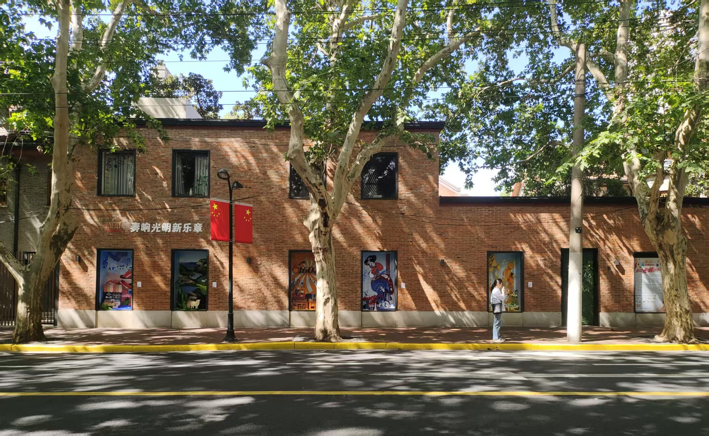

# SHU261_Final_CafeScene_Wwise

初始化于 2026-11-09。

## 开始使用

```bash
git clone https://github.com/Suki-moon/SHU261_cafe.git
cd SHU261_cafe
```

## 说明


# 僻静街道咖啡馆 - 3D环境声设计 

## 📝 项目简介
本项目为《基础实践》期末作品，旨在通过数字音频工作站（REAPER）与游戏音频中间件（Wwise），设计并搭建一套位于秋季僻静街道旁的咖啡馆环境声系统。
作品听觉重心集中在**咖啡馆室内**，整体基调安静、舒适，通过基底循环声与各类随机的日常细节音效，构建出真实的室内外空间感。

## 🛠️ 使用工具
*   **音频剪辑与处理**：REAPER v7.83
*   **游戏音频中间件**：Wwise 2025.1.11.9262

## 场景描述




本作品选取的场景为秋季僻静街道旁的一家咖啡馆。街道两旁种着梧桐树，秋风微凉，而咖啡馆内则透着温暖舒适的氛围。场景的听觉重心完全集中在室内，整体基调安静、闲适，没有嘈杂的喧闹声，只有属于咖啡馆的日常细节与少量室外声音。

咖啡馆内播放着悠扬的音乐，作为基底声。咖啡馆内氛围舒适惬意，有客人的脚步声、椅子挪动声、咖啡勺碰杯壁的声音、倒咖啡的声音、咖啡杯放置声。咖啡馆所处的街道静谧，室外偶尔的自行车铃声可以穿过墙面和玻璃在室内被听到，门口的风铃声在风轻吹会客人来临时发出清脆的声音。

## 🎧 声音资产清单 (WAV Format: 48kHz / 24bit / Stereo)
### 1. 基底环境声 (Base)
*   `base_cafe_music.wav` (约169秒)：包含室内极弱的空气底噪与背景白噪音，用于铺底。在 Wwise 中设置为 `Loop Infinite`（无限循环）。

### 2. 随机细节音效 (Random SFX)
所有短音效均在 Wwise 中放入 `Random Container`（随机容器），并开启 `Shuffle` 模式以避免机械重复。
*   **室内近景**：
    *   `random_chair_move` (x5)：椅子挪动声
    *   `random_cup_placed_on_table` (x6)：咖啡杯放置声
    *   `random_pouring_coffee` (x2)：咖啡冲泡水流声
    *   `random_footsteps` (x4)：室内脚步声
*   **室外远景**：
    *   `random_wind_chimme` (x6)：屋檐风铃声
    *   `random_bike_bell` (x4)：街道自行车铃声

## ⚙️ Wwise 交互逻辑与技术实现
1.  **随机触发**：利用 `Random Container` 管理所有短音效变体，设置 `Limit Repetition` 防止同一声音连续触发。
2.  **空间定位 (Positioning)**：所有随机声均开启 `3D Spatialization` (`Position + Orientation`)，并将 `Pan/3D Mix` 设为 `100`。
3.  **距离衰减 (Attenuation)**：为随机声绑定自定义衰减曲线。通过调整 `Max distance` 区分室内近景（极短距离）与室外远景（较长距离）。
4.  **频段模拟**：在衰减曲线中启用了 `Low-pass Filter`（低通滤波），模拟声音在空气中远距离传播时高频损失的物理现象。

### 📂 仓库目录结构 (Wwise Project Structure)

本仓库包含了完整的 Wwise 工程源文件及音频资产，主要目录结构说明如下：

*   **`autumu_cafe_ambinece.wproj`**：Wwise 主工程文件，双击即可在 Wwise 中打开此项目。
*   **`.gitignore` / `.p4ignore`**：Git 忽略规则文件，用于防止上传 Wwise 运行时产生的庞大缓存文件。
*   **`Containers/`**：音频层级结构（Actor-Mixer Hierarchy）。包含了本项目所有的基底音（Base）和随机容器（Random Container）的树状组织。
*   **`Events/`**：事件文件夹。包含了用于触发声音播放的各类 Play 事件（如 `Play_base_cafe_music` 等）。
*   **`Originals/`**：原始音频资产文件夹。存放了经过 REAPER 剪辑并导出的 48kHz / 24bit / Stereo 的原始 `.wav` 文件。
*   **`Attenuations/`**：衰减曲线共享集。包含了为 3D 随机声音（如风铃、落叶、杯子）自定义的距离衰减与低通滤波（Low-pass Filter）曲线。
*   **`Soundcaster Sessions/`**：测试会话文件夹。保存了用于最终预览和验证 3D 距离衰减效果的 Soundcaster 测试场景。
*   **`Busses/`**：混音总线结构（如 Main Audio Bus 等）。
*   *(其他如 States, Switches, Presets 等为 Wwise 默认生成的工程结构文件夹，主要用于管理工程配置)*
